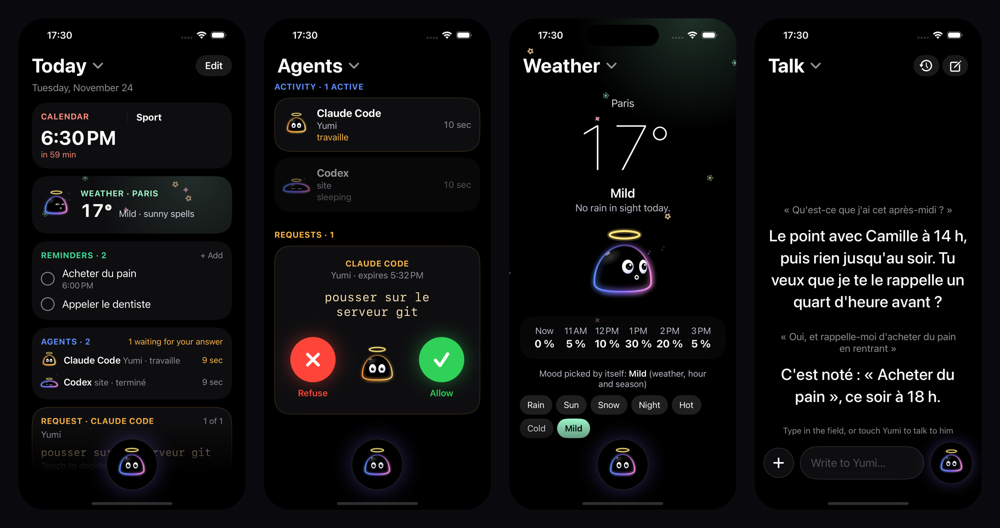

<p align="center">
</p>

<h1 align="center">Yumi</h1>

<p align="center">
  <b>The little AI in your notch that asks before it acts.</b>
</p>

<p align="center">
  Yumi does small things for you (reminders, calendar events, notes and more),<br>
  shows you exactly what will change, waits for your click, then checks it really happened.
</p>

<p align="center">
  <a href="https://github.com/estebanbaigts/Yumi/releases"><b>⬇ Download the free alpha</b></a>
  ·
  <a href="https://estebanbaigts.github.io/Yumi/">Website</a>
  ·
  <a href="#teach-yumi-a-new-trick">Teach Yumi a new trick</a>
</p>

<p align="center">
  
  
  
  <a href="https://github.com/estebanbaigts/Yumi/stargazers"></a>
</p>

<!--
  PROOF ASSET TO PRODUCE (docs/proof.gif): one unedited take, English interface.
  "Remind me to call mom tomorrow at 10" → Yumi's approval card with the exact reminder →
  click → the Reminders app shows it → Yumi says it checked. Replace the screenshot below
  with it. Do not stage it: record the real app.
-->
<p align="center">
  
</p>

---

## What can Yumi actually do?

**Small actions. Real results.** You ask in plain words, in the notch. Every action below exists in the app today.

| You say | Yumi does | Asks first |
|---|---|---|
| « Remind me to call the dentist tomorrow at 10 » | Adds the reminder to **Reminders** | Yes |
| « Block Thursday 2 pm, client meeting » | Adds the event to **your own calendar**, never with guests | Yes |
| « Create todo.md with two tasks » | Creates a text file in **Downloads** (or Desktop, Documents if you say so); never replaces a file | Yes |
| « Add "buy bread" to my todo » | Adds a line to a file **he created** | Yes |
| « Add "call Paul" to my Notion tasks » | Adds a task to **Notion**, or ticks one done | Yes, every time |
| « I'm working for 45 minutes » | Starts a **focus** session | No, nothing changes |
| « How much free time do I have tomorrow? » | Sums up your day, up to two weeks ahead | No, read only |

He can also tell the time and see which app and window are in front, when you let him.

He does **not** control your whole Mac. He never deletes, moves, sends a message or an email on his own, runs a command, or edits a file he did not create. A request he cannot do is refused, and he says why. (In the Mail module, a reply he suggests opens as a draft in Mail, or with Gmail leaves only when you press **Send** yourself.) New tricks come with each release.

## Yumi on your iPhone

The same Yumi lives on the iPhone: your day as long cards (calendar, weather, reminders, agents, mail, GitHub), Yumi at the bottom of every screen to talk to him, and his weather moods.

<p align="center">
  
</p>

- **Linked to your Mac through your own iCloud** (no server of ours): your coding agents and their requests on the iPhone, Allow or Refuse from the Lock Screen or the Dynamic Island, and the Mac checks every answer before acting.
- **Thinks with your Mac's Claude Code**, on your own subscription: no API key. Without the Mac, Gemini with its free key, or Apple's on-device model.
- **Give him a file or a photo** (an invoice, a letter): he says what it is and what to do. Only what you pick reaches him.
- **Widgets and Live Activities**: the next thing of your day, your agents, and Yumi in the weather.

## Why Yumi?

**Lives in your notch.** Not another chat window: he sits at the top of your screen, shows what matters now, and sometimes speaks first (a meeting coming, two hours without a break).

**Does small things for you.** Reminders, events, notes, Notion tasks. Real changes in your real apps, not just answers.

**Always asks first.** Before anything changes, he shows you exactly what he will do (the file and its content, the reminder, the event) and waits for your click. **After the action, he checks the result**: if the reminder or the file is not really there, he says so.

## You stay in control

- **Nothing changes without your approval.** Every action that creates or modifies something waits for your click, unless you chose to allow it for the session or always. Outside services are asked every time.
- **The model only proposes.** Your request becomes a plan; Yumi's code checks it (known tools, valid arguments) before anything runs.
- **One checkpoint.** Every step goes through a single permission manager. Secrets, system folders, payments and `sudo` are refused outright.
- **Leaving your Mac is high risk.** Writing to an outside service such as Notion is asked every time and cannot be remembered.
- **Checked afterwards.** The run fails if the result is not really there.
- **A history of decisions** stays on your Mac (Settings › Permissions): which tool, which file or site, what was decided. Never the content.
- **No account, no telemetry.** No server of ours. Out of the box, Yumi runs on Apple's on-device model or in simple mode: nothing leaves your Mac. Your messages go elsewhere only if you plug in another AI engine.

Details: [How the safety model works](#how-the-safety-model-works) and [Privacy](#privacy).

## For developers: Claude Code in your notch

Every session, in every terminal and editor, appears in the notch with **what it is working on**: your request, the current task of Claude's todo list and its progress (« 3/7 »), the action in progress (« Edits IslandModel.swift », « Runs swift test »), the last files and commands, and a short summary when a turn ends. Click a session to unfold it, or to open its terminal.

When Claude Code asks for a permission, the island opens and you answer **Allow**, **Always** or **Deny** without leaving what you are doing. If you do not answer, the question goes back to Claude Code as usual.

All of this comes from Claude Code's hooks and, for Claude's last message, from the session transcript on your Mac. None of it is sent anywhere. Keys and tokens that appear in commands are masked.

<p align="center">
  
</p>

## Install

**Requirements:** macOS 15 or later. A Mac with a notch is recommended. **No account and no AI subscription needed:** Yumi works from the first launch with Apple's on-device model (macOS 26 with Apple Intelligence) or, on any Mac, in simple mode. You can plug in a bigger engine later: Claude Code, an Anthropic, OpenAI or Gemini key, or Ollama (see [Engines](#engines)). Claude Code is only required to follow your Claude Code sessions.

1. Download `Yumi-<version>.zip` from the [latest release](https://github.com/estebanbaigts/Yumi/releases).
2. Unzip it and drag **Yumi.app** into **Applications**.
3. Open it. The alpha is **not notarized by Apple yet**, so macOS blocks the first launch: open **System Settings › Privacy & Security** and click **Open Anyway**. Only once.
4. Yumi appears in the notch. Right-click him for the settings.

Yumi tells you when a new version is out, at most once a day. He never downloads or installs anything by himself.

**Check the download.** Every release is built by GitHub Actions from the public code, not on a personal machine. The release page lists `SHA256SUMS.txt` and a build provenance attestation:

```bash
shasum -a 256 Yumi-0.1.0-alpha.9.zip
```

```bash
gh attestation verify Yumi-0.1.0-alpha.9.zip --repo estebanbaigts/Yumi
```

Yumi tells you when a new version is out, at most once a day. He never downloads or installs anything by himself.

## Alpha

Yumi is a public alpha, **0.1.0-alpha.9**: free, open source, and moving fast.

- **New in alpha 9:** a redesigned island in three tabs (Work, Day, Unwind) with bento cards, the island colour of your choice, costumes for Yumi, a Gmail module, Deezer and YouTube Music, a focus length you choose, and GitHub news told as they happen.

- **Works today:** the actions above, with approval and verification; Claude Code sessions and approvals; the modules (calendar, reminders, focus, music, weather, GitHub, Notion, Mail or Gmail); memory; English and French.
- **Still rough:** see [Known limitations](#known-limitations). Not notarized, not tested on Macs without a notch, and one request cannot yet read then act (« prepare my day »).
- **Something broke?** [Open a bug report](https://github.com/estebanbaigts/Yumi/issues/new?template=bug.yml), or use **Send feedback** in Yumi's menu ([form](https://tally.so/r/Me9lvA), no account needed).

## Teach Yumi a new trick

What should Yumi learn next? [Suggest a new trick](https://github.com/estebanbaigts/Yumi/issues/new?template=trick.yml): what you would say to him, and what he should do. The best ideas become the next releases.

Want to build one yourself? Every action is a small Swift tool with the same contract (check, run, verify): see [CONTRIBUTING.md](CONTRIBUTING.md).

## Roadmap

- **New tricks:** read then act (« prepare my day »), with the whole plan shown before the first question. Then the tricks you ask for.
- **Easier install:** notarized releases, once the Apple Developer account exists.
- **More of your apps:** modules described in a file instead of written in the code, always behind the same permission checkpoint.
- **Every Mac:** Macs without a notch, tested and polished.
- **Windows and Linux:** not planned for now. If you want them, [say so](https://tally.so/r/Me9lvA).

---

# Details

<sub>Built with Swift 6, SwiftUI and AppKit, with no third-party dependency. The character is drawn in code.</sub>

## Modules

The open island files modules under three tabs in the menu bar, **Work**, **Day** and **Unwind**, each laid out as a bento of cards. Pick the island colour and Yumi's costume in the island settings.

You choose which modules appear and in which order: drag and drop in **Settings › Modules**, or right in the island with **Edit**.

| Module | What it shows | What it needs |
|---|---|---|
| **Claude Code** | Every session, live: request, task progress, current action, approvals | Yumi's hooks (offered in the island) and `python3` |
| **GitHub** | Activity on all your repositories, grouped by repository: pushes with their exact commits, commits today and this week, pull requests and their checks, stars, forks, releases | A read-only personal access token, or the Yumi GitHub App (sign in with a code, install it on your account and as many organisations as you like) |
| **Notion** | Today's and late tasks from the databases you choose: title, database, a date pill, late ones first. Click to open the page; tick the circle to mark it done in Notion (asked every time) | An internal integration key, and the databases shared with it |
| **Agenda** | Your next event of the day | Calendar access |
| **Notes** | Today's reminders, ticked from the notch | Reminders access |
| **Mail** | Your latest mails from the Mac's Mail app (every account set up there: Gmail, iCloud, Outlook, work), the important ones apart, the account on each mail, and answers Yumi suggests, opened as a draft in Mail that you send yourself. Gmail with an app password stays an option | Nothing by default: macOS asks once to let Yumi read Mail (Automation). For Gmail: your address and a Google app password (kept in the Keychain) |
| **Focus** | A work timer and its breaks, the length you choose | Nothing |
| **Music** | The track or video playing, pause, next, previous: Music, Spotify, Deezer, YouTube Music, YouTube, SoundCloud, Twitch or Vimeo in any browser (the tab in front of its window), and any other page a browser plays, such as a web radio, shown by its window title (not in Safari) | Automation for Music and Spotify; Accessibility for the others |
| **Weather** | The sky where you are | Location, or a city typed by hand |
| **Screen time** | Your active time on the Mac today against a daily threshold you choose, hour by hour, the last seven days, the average, median and 75th percentile; Yumi says it once when you reach the threshold, then at every extra hour. While it is on, the two-hour break reminder also restarts after five minutes away from an open Mac | Nothing |

## Getting around

| | |
|---|---|
| **Right-click Yumi** or the island | Settings, Send feedback, Quit |
| **⌘,** / **⌘Q** | Settings / Quit, when the island is active |
| **Triple Shift** | Opens or folds the island (needs Accessibility outside the island) |
| **Click outside** | Folds the open island, unless an approval is waiting or the chat has unsent text |
| **Work · Day · Unwind** | The tabs of the open island, in the menu bar next to the notch |
| **Start typing** in the open island | Opens the chat with Yumi |
| **Drag a file or a window onto Yumi** | Ask about it in the chat |

## Engines

The engine talks with you in the chat and proposes plans for actions. Whichever you use, **every plan is checked by Yumi** (known tools only, valid arguments, risk set by Yumi's code, not by the model), **every change asks you first**, and **the result is verified**. In the chat, no engine has a tool that changes your Mac.

**No account needed.** With nothing set up, Yumi uses Apple's model when your Mac has it, and the simple mode otherwise. **Automatic** takes the engine you set up first, then Apple, then the simple mode, which is always last. **Settings › Engines** lets you pick one, change the order, enter keys and models, and test each one. Under each answer, the chat shows discreetly which engine answered.

| Engine | What you need | What leaves your Mac, and who bills it |
|---|---|---|
| **Apple (on your Mac, free)** | macOS 26, Apple silicon, Apple Intelligence turned on (System Settings › Apple Intelligence & Siri). Yumi tells you in the island if the model is downloading, switched off or not available on your Mac. | Nothing leaves your Mac. No account. Free. |
| **Simple mode (no AI)** | Nothing. Always available. | Nothing leaves your Mac, no network at all. Understands common requests in French and English: reminders (« rappelle-moi d'appeler maman demain 18 h », "remind me to call mom tomorrow at 6pm"), tasks, calendar blocks, focus timer, the time, your day, and music (play, pause, next). When it does not understand, it says so and offers buttons. |
| **Claude Code** | Installed and logged in. Yumi runs it with no tool, shell, file, web, MCP server, settings or hooks. | Your messages go to Anthropic through your Claude Code account. Counted in your plan. |
| **Anthropic API** | A key | Your messages go to Anthropic. Billed per use. |
| **OpenAI API** | A key (default model `gpt-4o-mini`) | Your messages go to OpenAI. Billed per use. |
| **Google Gemini API** | A key (default model `gemini-2.5-flash`) | Your messages go to Google. Free tier to try, then billed. |
| **Ollama** | Ollama running on your Mac, with a model | Nothing leaves your Mac. Free. |

Keys are stored in the macOS Keychain. Yumi does not use other command-line agents (Codex, Gemini CLI): it cannot prove they run without tools.

## How the safety model works

```
Your request → engine proposes a plan → Yumi validates it → Permission gate → tool runs → Yumi verifies → result
```

- **The model only proposes.** A plan is accepted only if every step uses a known tool with valid arguments.
- **The risk comes from the code.** Each tool describes what it really does (read, create, modify); the risk level is computed from that, with fixed floors. The model cannot lower it.
- **Leaving the Mac is high.** Any change to an outside account or site (a Notion database, for instance) is at least high risk, whatever the tool says: it is asked every time, an "allow" rule turns into a question, and it cannot be remembered.
- **One gate.** Every step goes through a single permission manager: allowed (safe and local), asked, or refused (secrets, system folders, payments, `sudo`).
- **Approvals are precise and short-lived.** A request shows exactly what will change, expires after a minute on screen, and answers once.
- **Verification is a step.** If the file, reminder or event is not really there afterwards, the run fails and says so.
- **A history** of every decision stays on your Mac (Settings › Permissions): which tool, which file or site, what was decided. Never the content.

## Privacy

- No telemetry, no account, no server of ours.
- The memory never leaves your Mac. Calendar, reminders and Notion tasks are read on your Mac; the engine only receives Yumi's own one or two sentences about your day, which then stay in the conversation.
- When you open the chat, **the name of the app in front, its window title and the site's domain** are attached to your first message and shown in the notch (« With … »). **One click removes them.** The content of your screen is never sent. Only an explicit gesture (« Summarize », a window dragged onto Yumi, a dropped file) sends the full address or the file.
- A plan request sends your words, the last few messages, today's date and time, the list of Yumi's tools and the names of the files he created.
- Network calls go only to the services behind the modules you turned on (Open-Meteo, api.github.com and github.com for the GitHub App sign-in, api.notion.com) and to the engine you use. GitHub is read-only; Notion reads only the databases you tick, and writes there only after you approve (adding a task, ticking one done).
- **« Always »** on a Claude Code permission writes a permanent rule in your Claude Code settings. Remove it with `/permissions` in Claude Code.
- Tokens and keys are stored in the macOS Keychain, never on disk and never in git.

### Permissions

Yumi works without any of these. Each one unlocks a feature and is asked for when you first use it.

| Permission | What it is for |
|---|---|
| Calendar | Your next event, the events you ask for |
| Reminders | Today's reminders, the ones you ask for |
| Location | The weather where you are |
| Automation | Pause and next track, the address of the page you show him |
| Accessibility | The window you show him, the Escape key, triple Shift |
| Downloads, Desktop, Documents | The files you ask him to create, and add to |
| Login item | Launching at startup, if you turn it on |

## Known limitations

This is an alpha. Here is what we know is missing or rough today.

- **Not notarized by Apple.** The first launch needs « Open Anyway ». Notarization needs a paid Apple Developer account, not set up yet. Builds are signed with a local certificate so that macOS keeps your permissions across updates.
- **Macs without a notch** are not tested yet. The island falls back to a fixed size at the top of the screen.
- **Read then act is not there yet.** The agent can read (your day) or act (create, add), but not read and then act on what it read in one request, like « prepare my day ».
- **Notion** lists twelve tasks at most in the island. Ticking needs a "done" property (checkbox or status) chosen in the settings, and is only offered in the direct build.
- **GitHub** commits are listed flat, not foldable. Counts cover what GitHub's activity feed returns (90 days, 300 events).
- **Mail** reads the inbox of the Mail app only while Mail is open, shows the latest 10 mails of each account (Mail can take up to a minute to answer on a very large inbox), and never changes your mailbox. If you refuse the Automation access the module stays empty (System Settings, Privacy, Automation to change it). Not in the App Store build. The Gmail option needs a Google app password (two-step verification on).
- **Screen time** counts a minute when the session is unlocked and you touched the keyboard or mouse in the last five minutes, or a call, a film or a presentation keeps the display awake (two hours without input at most). It counts only while Yumi runs, never while the Mac sleeps, and keeps 90 days of totals and 14 days by hour in Yumi's folder. A threshold remark Yumi keeps to himself (Focus, a shared screen, the remarks of the day used up) is not said later.
- **Apple's model is small.** It is made for simple requests and short conversations; for long discussions or complex plans, plug in a bigger engine. It needs macOS 26 and Apple Intelligence.
- **The simple mode** only understands fixed forms of common requests (reminders, tasks, calendar, timer, music, the time, your day). It does not chat.
- **Gemini's free tier** can run out quickly; Yumi tells you which limit was hit and when it resets.
- **CPU**: about 10 % while an animated habit plays during an agent run, much less at rest.
- **The App Store build** is not shipped and cannot use Claude Code or the hooks.
- **Windows and Linux**: not planned for now. If you want them, [say so](https://tally.so/r/Me9lvA).

## Build from source

You need macOS 15 or later, a recent Xcode (Xcode 26 or later), [XcodeGen](https://github.com/yonaskolb/XcodeGen), and `python3` for the hook script (Homebrew's, python.org's, or Apple's after `xcode-select --install`).

```bash
brew install xcodegen
```

```bash
git clone https://github.com/estebanbaigts/Yumi.git
```

```bash
cd Yumi/Yumi && xcodegen && open Yumi.xcodeproj
```

Then ⌘R in Xcode. The Xcode project and the `Info.plist` files are generated from [Yumi/project.yml](Yumi/project.yml) and are not in git.

Tests run without launching the app:

```bash
cd Yumi && xcodegen && xcodebuild -scheme Yumi -configuration Debug test CODE_SIGNING_ALLOWED=NO
```

Continuous integration builds and tests every push. Pushing a tag `v<version>` builds, signs, zips and attests a release draft ([.github/workflows/release.yml](.github/workflows/release.yml)).

## Repository

```
Yumi/                  the app (Sources/App, Tests, Resources, project.yml)
release/               the install guides shipped in the zip
design/                character reference, voice (French and English), video plan
motion/                the presentation films, made with Remotion
site/                  the website
docs/                  architecture, journal of decisions, backlog, images
```

- [docs/architecture.md](docs/architecture.md): the map of the code, folder by folder.
- [docs/journal.md](docs/journal.md): decisions and work plan (in French).
- [CONTRIBUTING.md](CONTRIBUTING.md): how to build, test and propose a change.

## Origin and license

Yumi is an independent project. Its first lines of code came from an MIT-licensed notch app, credited in [ATTRIBUTION.md](ATTRIBUTION.md).

The code is under the [MIT License](LICENSE). The Yumi name, the character, the icons, the sounds and the films in `motion/` are not: see [LICENSE-ASSETS.md](LICENSE-ASSETS.md) and [motion/LICENSE.md](motion/LICENSE.md).
